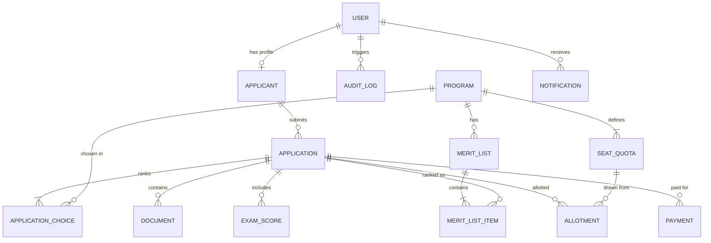
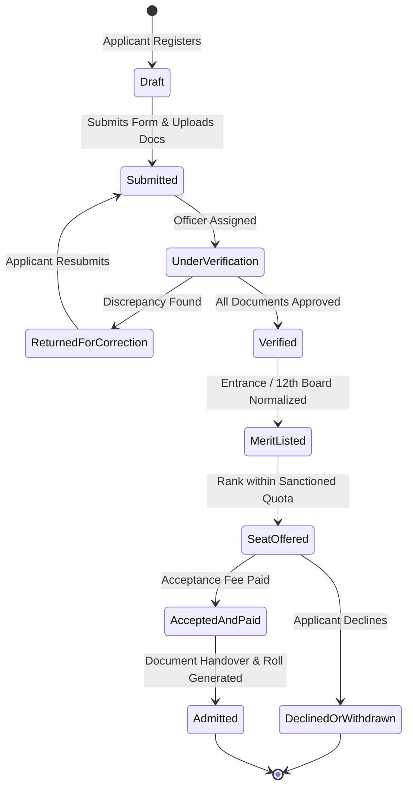

<div align="center">

# 🎓 College Admission Management System
### Relational Database Management System (RDBMS) & Full-Stack Web Platform

[](https://github.com/itz-Ansh/RDBMS/actions/workflows/ci.yml)
[](https://nodejs.org/)
[](https://www.typescriptlang.org/)
[](https://nextjs.org/)
[](https://nestjs.com/)
[](https://www.postgresql.org/)
[](https://www.prisma.io/)
[](https://redis.io/)
[](https://turbo.build/repo)
[](LICENSE)

<p align="center">
  <strong>An enterprise-grade, auditable admissions portal engineered for higher education institutions.</strong><br>
  Streamlines the student lifecycle from online application and document verification to merit generation, seat allotment, and fee reconciliation.
</p>

</div>

---

## 📌 Academic Project Details

> [!NOTE]
> **College Project Notice:** This project was conceptualized, designed, and implemented as a comprehensive **Academic College Project** for the university curriculum under the assigned topic: **College Admission Management System**.

| Academic Information | Submission Details |
| :--- | :--- |
| **Project Topic** | **College Admission Management System** |
| **Course / Subject** | **Relational Database Management Systems (RDBMS)** / Advanced Software Engineering |
| **Curriculum Context** | Capstone Database & Full-Stack System Design Project |
| **Author / Student** | [itz_Ansh](https://github.com/itz-Ansh) |
| **Project Objective** | Eliminate paper applications, spreadsheets, and manual errors with an ACID-compliant, auditable, multi-actor relational database platform. |
| **Architectural Model** | Clean Architecture, Modular Monolith (NestJS), Monorepo (Turborepo), Next.js App Router |

---

## 🎯 Problem Statement & Motivation

Traditional college admissions suffer from fragmented paper forms, uncoordinated spreadsheets, lack of concurrency controls during seat allocation, and zero auditability. 

This project solves these systemic issues by implementing:
1. **ACID-Compliant Relational Design**: Guarantees that seat quotas and fee reconciliations are never compromised by race conditions or over-allocations.
2. **Third Normal Form (3NF) Database Normalization**: Clean entity separation across Users, Applicants, Academic Programs, Quotas, Applications, Documents, Scores, Allotments, and Payments.
3. **Role-Based Access Control (RBAC)**: Fine-grained permissions across 6 distinct academic actor roles.
4. **India's DPDP Act 2023 Compliance**: Personal identifiable data (e.g., Aadhaar) stored masked (`XXXX-XXXX-1234`), with explicit digital consent timestamps and immutable audit trails.

---

## 🏛️ System Architecture

The project is structured as an **npm workspaces + Turborepo** monorepo:

```
RDBMS/
├── .github/
│   ├── workflows/ci.yml         # GitHub Actions CI for lint, tests, and builds
│   ├── ISSUE_TEMPLATE/          # Bug reports, feature requests, academic reviews
│   └── pull_request_template.md # PR standards and verification checklist
├── apps/
│   ├── api/                     # NestJS 10+ Modular Monolith (TypeScript, OpenAPI/Swagger)
│   │   ├── src/
│   │   │   ├── common/          # @Roles(), Guards, Filters, Interceptors
│   │   │   ├── modules/         # Auth, Users, Programs, Seats, Health, etc.
│   │   │   └── main.ts          # Bootstrap with Helmet, CORS, Swagger docs
│   │   └── package.json
│   └── web/                     # Next.js 14+ App Router (TypeScript, Tailwind CSS)
│       ├── src/
│       │   ├── app/             # Public landing, (auth), dashboard, programs
│       │   ├── components/      # Accessible UI components (Navbar, Footer, etc.)
│       │   └── lib/             # API client, session management
│       └── package.json
├── packages/
│   ├── database/                # Centralized Prisma ORM, migrations & seed generator
│   │   ├── prisma/
│   │   │   ├── schema.prisma    # Complete 3NF relational data model
│   │   │   └── seed.ts          # Deterministic seed script for all 6 roles
│   │   └── package.json
│   └── shared/                  # Shared contracts, DTOs, Enums, and TypeScript interfaces
│       ├── src/enums/           # Role, ApplicationStatus, QuotaCategory, PaymentStatus
│       └── package.json
├── infra/
│   └── docker-compose.yml       # PostgreSQL 16, Redis 7, MinIO S3 storage
├── docs/
│   └── ARCHITECTURE.md          # Architectural blueprints, security, state machine
├── .env.example                 # Root environment configuration template
├── CONTRIBUTING.md              # Contribution standards and Conventional Commits
├── CODE_OF_CONDUCT.md           # Contributor Covenant 2.1
├── SECURITY.md                  # Security, DPDP Act 2023, and disclosure policy
└── LICENSE                      # MIT License with Academic attribution
```

---

## 🗄️ Relational Database Schema & Data Model

The PostgreSQL schema is managed via **Prisma ORM** ([packages/database/prisma/schema.prisma](file:///c:/Users/itz_Ansh/Documents/RDBMS/packages/database/prisma/schema.prisma)) and adheres strictly to Third Normal Form (3NF):



### Key RDBMS Concurrency & Integrity Controls
- **Seat Allocation Transactions**: Seat allotment executes inside an atomic Prisma `$transaction` with optimistic version counters.
- **Database Constraints**: SQL check constraint `CHECK (allotted_seats <= total_seats)` prevents over-subscription under concurrent requests.
- **Cascading & Referential Integrity**: Foreign keys ensure orphaned applications or choice rankings cannot exist.

---

## 👥 Role-Based Access Control (RBAC) Matrix

Every API route and dashboard view enforces role-based validation:

| Resource / Endpoint | Applicant | Admission Officer | Reviewer / HOD | Accounts | Admin | Auditor |
| :--- | :---: | :---: | :---: | :---: | :---: | :---: |
| **Public Programs & Seats** | Read | Read | Read | Read | Read | Read |
| **Manage Programs & Quotas** | ❌ | ❌ | ❌ | ❌ | Read / Write | Read |
| **Submit Application & Uploads**| Owner RW | ❌ | ❌ | ❌ | ❌ | ❌ |
| **Verify / Return Documents** | ❌ | Read / Write | ❌ | ❌ | Read / Write | Read |
| **Review Shortlisted Applications** | ❌ | ❌ | Read / Write | ❌ | Read / Write | Read |
| **Reconcile Payments & Receipts**| ❌ | ❌ | ❌ | Read / Write | Read / Write | Read |
| **Generate Merit & Allotments** | ❌ | ❌ | ❌ | ❌ | Read / Write | Read |
| **Audit Trails & System Logs** | ❌ | ❌ | ❌ | ❌ | Read | Read |

---

## 🔄 Admissions Lifecycle State Machine

Application status transitions are enforced server-side, logged immutably, and trigger real-time notifications:



---

## 🚀 Quickstart Guide

### 1. Prerequisites
- **Node.js**: v20+ or v24+
- **npm**: v10+ or v11+
- **Docker & Docker Compose**: v24+ (for PostgreSQL 16 & Redis 7)

### 2. Environment Configuration
Copy the sample environment variables:
```bash
cp .env.example .env
```

### 3. Start Infrastructure (PostgreSQL & Redis)
```bash
npm run docker:up
```

### 4. Install Dependencies
```bash
npm install
```

### 5. Generate Prisma Client & Run Migrations
```bash
# Generate Prisma Client
npm run db:generate

# Apply migrations to PostgreSQL
npm run db:migrate

# Seed initial programs, quotas, and test accounts
npm run db:seed
```

### 6. Run the Development Servers
```bash
npm run dev
```

- **Web Portal**: [http://localhost:3000](http://localhost:3000)
- **API Server**: [http://localhost:4000](http://localhost:4000)
- **Interactive Swagger OpenAPI Docs**: [http://localhost:4000/api/docs](http://localhost:4000/api/docs)

---

## 🔑 Pre-Seeded Test Credentials for Evaluation

For examination, evaluation, and grading, all 6 actor roles are pre-seeded:

| Role | Email | Password | Academic Description |
| :--- | :--- | :--- | :--- |
| **Admin** | `admin@college.edu` | `Password@123` | Institutional manager: quota allocations, cut-offs, program catalog |
| **Admission Officer** | `officer@college.edu` | `Password@123` | Verification officer: checks uploads, approves or returns with reason |
| **Reviewer / HOD** | `hod.cse@college.edu` | `Password@123` | Department chair: department-level shortlisting and review |
| **Accounts** | `accounts@college.edu` | `Password@123` | Accounts office: fee reconciliation, receipts, refund audits |
| **Auditor** | `auditor@college.edu` | `Password@123` | Compliance officer: read-only access to tamper-evident audit logs |
| **Applicant (Verified)** | `applicant.rahul@example.com` | `Applicant@123` | Rahul Sharma (Pre-verified OBC-NCL candidate) |
| **Applicant (Draft)** | `applicant.priya@example.com` | `Applicant@123` | Priya Patel (General candidate with active draft application) |

---

## 🧪 Testing & Validation

```bash
# Run unit tests across all workspaces
npm test

# Run API unit and RBAC tests specifically
npm run --workspace=apps/api test

# Test clean production build across all packages
npm run build
```

---

## 🗺️ Project Implementation Roadmap

- [x] **Phase 1: Foundation & Monorepo Setup**
  - Turborepo + npm workspaces, NestJS API, Next.js Web, Prisma 3NF schema, RBAC guards, seat quotas, seed data, and testing suite.
- [ ] **Phase 2: Application Form, Document Upload & Officer Verification**
  - Multi-step application wizard, S3 presigned document uploads, verification dashboard.
- [ ] **Phase 3: Fee Payment, Notifications & Audit Log**
  - Sandbox payment gateway integration, BullMQ worker notifications, immutable audit log viewer.
- [ ] **Phase 4: Merit Ranking, Allotment Rounds & Reports**
  - Category-wise merit calculation, multi-round allotment engine, tabular CSV/PDF report exports.
- [ ] **Phase 5: Performance Optimization, Security Audit & Pilot Deployment**
  - Load testing (5,000 concurrent simulated requests), OWASP Top 10 hardening, production deployment guide.

---

## 📄 License & Academic Attribution

This project is licensed under the [MIT License](LICENSE) with an academic educational disclaimer. Developed for academic coursework and university evaluation under the assigned topic: **College Admission Management System**.
