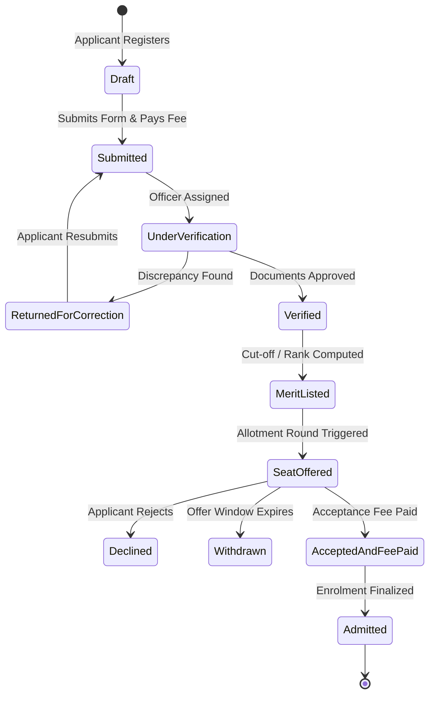

# College Admission Management System - System Architecture & Technical Specification

## 1. Executive Overview

The **College Admission Management System** is a unified, auditable, high-performance web platform designed to transition a student seamlessly from initial enquiry to confirmed admission. It eliminates spreadsheets and paper-based processes in favor of a robust, transactional state machine with server-side validation, role-based access control (RBAC), fine-grained audit trails, and automated notifications.

---

## 2. Monorepo & Technology Stack

The codebase is structured as an **npm workspaces + Turborepo** monorepo:

```
├── apps/
│   ├── api/             # NestJS 10+ Modular Monolith (TypeScript, OpenAPI/Swagger, Throttler)
│   └── web/             # Next.js 14+ App Router (TypeScript, Tailwind CSS, WCAG 2.1 AA)
├── packages/
│   ├── database/        # Prisma ORM schema, versioned migrations, deterministic seed data
│   └── shared/          # Shared contracts, enums, DTOs, and validation logic
├── infra/               # Docker Compose (PostgreSQL 16, Redis 7, MinIO S3 storage)
└── docs/                # Architecture, API specifications, and operational runbooks
```

### Core Technologies
- **API Runtime**: NestJS 10.x running on Node.js 20+
- **Frontend**: Next.js 14.x with React 18 and Tailwind CSS
- **Database**: PostgreSQL 16 managed via Prisma ORM
- **Cache & Message Broker**: Redis 7.x (BullMQ background workers)
- **Object Storage**: S3-compatible private storage (MinIO for dev, AWS S3 for production)
- **Containerization**: Docker Compose for reproducible infrastructure

---

## 3. Modular Monolith Architecture (`apps/api`)

The backend is architected as a **Modular Monolith** where domain boundaries are enforced via NestJS modules:

```mermaid
graph TD
    Client[Web & Mobile Clients] --> Gateway[API Gateway / NestJS App]
    Gateway --> Throttler[Rate Limiter / Throttler Guard]
    Throttler --> AuthGuard[JWT & Roles Guards]
    AuthGuard --> AuditInterceptor[Audit Log Interceptor]
    
    subgraph Modular Monolith Domain Modules
        AuditInterceptor --> AuthMod[Auth Module]
        AuditInterceptor --> UserMod[Users & Applicant Module]
        AuditInterceptor --> ProgMod[Programs Module]
        AuditInterceptor --> SeatMod[Seats & Quota Module]
        AuditInterceptor --> AppMod[Applications Module (Phase 2)]
        AuditInterceptor --> DocMod[Documents Module (Phase 2)]
        AuditInterceptor --> PayMod[Payments Module (Phase 3)]
        AuditInterceptor --> MeritMod[Merit & Allotment Module (Phase 4)]
        AuditInterceptor --> RepMod[Reports & Audit Module (Phase 4)]
    end

    AuthMod --> Redis[(Redis Cache / OTP)]
    SeatMod --> Postgres[(PostgreSQL 16 via Prisma)]
    ProgMod --> Postgres
    UserMod --> Postgres
    AppMod --> Postgres
```

### Key Modules:
1. **`AuthModule`**: Handles staff password authentication, applicant password/OTP authentication, JWT access/refresh token rotation, and password hashing (bcrypt salt = 10).
2. **`UsersModule`**: Manages user profiles, applicant metadata, and DPDP consent records.
3. **`ProgramsModule`**: Manages course offerings, eligibility rules JSON, degrees, and academic requirements.
4. **`SeatsModule`**: Manages seat quotas by reservation category and executes concurrency-safe atomic seat increments/decrements.
5. **`CommonModule`**: Enforces system-wide guards (`JwtAuthGuard`, `RolesGuard`), interceptors (`TransformResponseInterceptor`, `AuditLogInterceptor`), and exception filters (`HttpExceptionFilter`).

---

## 4. Role-Based Access Control (RBAC) Matrix

The system enforces strict role-based authorization at the route handler level using `@Roles(Role.ADMIN, ...)` decorators and `RolesGuard`:

| Resource / Endpoint | Applicant | Admission Officer | Reviewer / HOD | Accounts | Admin | Auditor |
| :--- | :---: | :---: | :---: | :---: | :---: | :---: |
| **Public Programs & Seats** | Read | Read | Read | Read | Read | Read |
| **Manage Programs & Quotas** | ❌ | ❌ | ❌ | ❌ | Read / Write | Read |
| **Submit Application & Uploads**| Owner RW | ❌ | ❌ | ❌ | ❌ | ❌ |
| **Verify / Return Documents** | ❌ | Read / Write | ❌ | ❌ | Read / Write | Read |
| **Review Shortlisted Applications** | ❌ | ❌ | Read / Write | ❌ | Read / Write | Read |
| **Reconcile Payments & Receipts**| ❌ | ❌ | ❌ | Read / Write | Read / Write | Read |
| **Generate Merit & Allotments** | ❌ | ❌ | ❌ | ❌ | Read / Write | Read |
| **Audit Trails & System Logs** | ❌ | ❌ | ❌ | ❌ | Read | Read |

---

## 5. Application Status State Machine

Every status transition is validated server-side, logged to the `AuditLog` table with the actor's ID and IP, and triggers an applicant notification:



---

## 6. Concurrency & Race-Condition Defense

Under deadline peaks (up to 5,000 concurrent applicants and 100 submissions/sec), race conditions on seat availability must be strictly prevented.

### Multi-Layer Defense:
1. **Interactive Transactions**: Seat reservations run inside Prisma `$transaction(async (tx) => { ... })`.
2. **Pessimistic Locking**: `SELECT * FROM "SeatQuota" WHERE id = $1 FOR UPDATE` locks the specific program quota row during allotment.
3. **Database Check Constraints**: `CONSTRAINT chk_seats CHECK (allotted_seats <= total_seats)` directly enforced by PostgreSQL.
4. **Optimistic Versioning**: A `version` counter on `SeatQuota` detects conflicting concurrent updates.

---

## 7. Data Privacy & DPDP Act 2023 Compliance

1. **Consent Management**: Registration captures mandatory consent (`dpdpConsentGivenAt`) with an explicit purpose specification.
2. **Data Minimization & Masking**: National identity numbers (e.g., Aadhaar) are stored in masked format (`XXXX-XXXX-1234`).
3. **Private Document Storage**: All uploaded identity proofs, marksheets, and caste certificates are stored in private S3 buckets. Direct public URLs are never generated. Instead, time-bounded (15-minute) pre-signed URLs are issued only to authorized officers and the applicant owner.
4. **Immutable Audit Trails**: Every access to PII and every status change creates an immutable `AuditLog` row.

---

## 8. OpenAPI Specification & Observability

- **API Documentation**: Interactive Swagger docs served at `/api/docs`.
- **Standardized Response Envelope**:
  ```json
  {
    "success": true,
    "data": { ... },
    "message": "Operation completed successfully",
    "timestamp": "2026-10-21T12:00:00.000Z"
  }
  ```
- **Standardized Error Envelope**:
  ```json
  {
    "success": false,
    "statusCode": 400,
    "error": "Bad Request",
    "message": "Validation failed",
    "timestamp": "2026-10-21T12:00:00.000Z",
    "path": "/api/auth/register"
  }
  ```
- **Health Probes**: Liveness and readiness endpoints at `/api/health` monitoring PostgreSQL and Redis connectivity.
